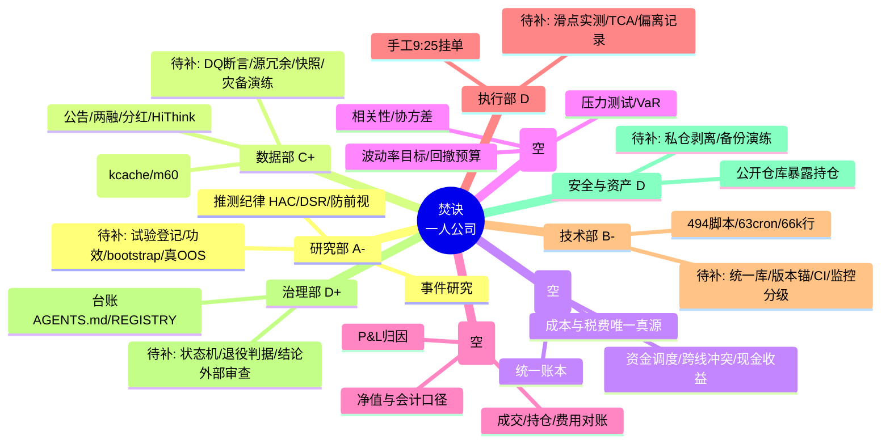
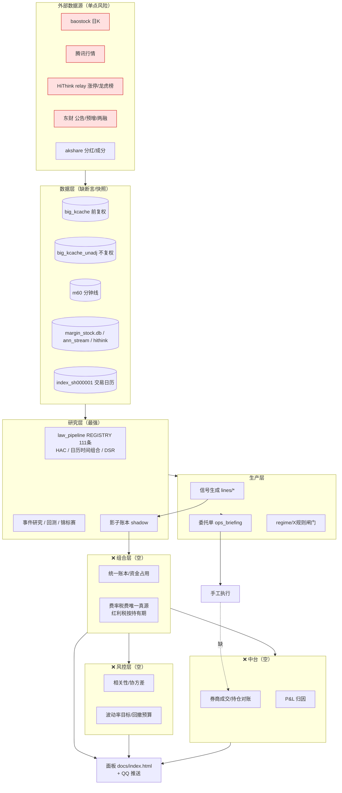
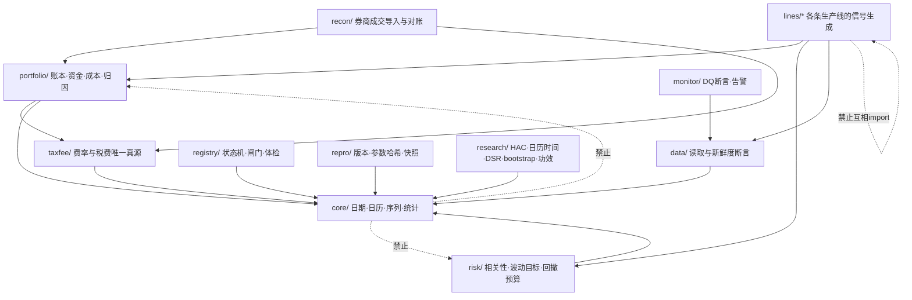

# 焚诀思维导图（Mermaid，GitHub 直接渲染）

> 三张图：① 部门模型 ② 系统与数据流 ③ 目标模块依赖。
> 判断"某件事属于谁"时看①；判断"数据从哪来到哪去"看②；判断"代码该放哪、谁能 import 谁"看③。

---

## ① 部门模型（他的一人公司）

---

## ② 系统与数据流（现状 + 目标态缺口标红点）

---

## ③ 目标模块依赖（单向，只许向下）

规则：`lines/` 之间**不得互相 import**（跨线共享必须下沉到 `core/` 或 `portfolio/`）；
`core/` 只依赖标准库与 numpy/pandas；**所有费用与税费只能来自 `taxfee/`**。
